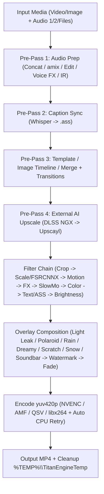

# TitanEngine

> **Windows WPF Video Editor & Batch Render Engine** chạy trên **FFmpeg CLI**, zero NuGet dependency, hỗ trợ vừa thao tác trực quan qua **UI Mode** vừa tự động hóa qua **Localhost HTTP API (Host Mode)**.


---

## Mục lục

1. [Tổng quan](#1-tổng-quan)
2. [Tính năng chính](#2-tính-năng-chính)
3. [Soundbar Audio Visualizer (16 Styles · 30 Palettes)](#3-soundbar-audio-visualizer-16-styles--30-palettes)
4. [Kiến trúc & Render Pipeline](#4-kiến-trúc--render-pipeline)
5. [Localhost HTTP API (Host Mode / BAS Automation)](#5-localhost-http-api-host-mode--bas-automation)
6. [Cài đặt, Build & Chạy ứng dụng](#6-cài-đặt-build--chạy-ứng-dụng)
7. [Cấu trúc thư mục](#7-cấu-trúc-thư-mục)
8. [Hiệu năng đã đo](#8-hiệu-năng-đã-đo)
9. [Tài liệu kỹ thuật & Quy chuẩn phát triển](#9-tài-liệu-kỹ-thuật--quy-chuẩn-phát-triển)
10. [Lưu ý kỹ thuật đã biết](#10-lưu-ý-kỹ-thuật-đã-biết)

---

## 1. Tổng quan

**TitanEngine** nhận nguồn **video hoặc hình ảnh**, xử lý qua một pipeline FFmpeg thống nhất và xuất **MP4** (`yuv420p`), tối ưu cho sản xuất video ngắn hàng loạt (Reels / TikTok / Shorts / Music Visualizer).

Ứng dụng hoạt động ở **2 chế độ dùng chung 1 pipeline lõi** (`EngineCore.ExecuteRenderAsync`):

1. **UI Mode**: Giao diện tối hiện đại (WPF `1280×920`), hỗ trợ kéo-thả media, chỉnh sửa trực quan (Visual Crop Editor, Visual Watermark Editor, Audio Editor, Soundbar live preview), tạo hàng đợi (`JobQueue`) và theo dõi log FFmpeg theo thời gian thực.
2. **Host Mode (Local HTTP API)**: Bật server HTTP nội bộ (`HttpListener`, mặc định `http://127.0.0.1:5555/`) bằng nút **HOST** để tích hợp với **BAS** hoặc script automation. Khi tắt, mọi endpoint trả `503 Host mode is OFF`.

### Tech stack

| Thành phần | Chi tiết |
|---|---|
| Ngôn ngữ & Framework | C# / `.NET 8.0-windows` · WPF (`WinExe`) · `Nullable` + `ImplicitUsings` |
| Package phụ thuộc | **0 NuGet packages** (thuần .NET BCL + WPF + CLI ngoài) |
| Render Engine | `ffmpeg.exe` + `ffprobe.exe` đặt cạnh `TitanEngine.exe` |
| AI Upscale (3 tầng) | NVIDIA DLSS NGX (`DLVSR.exe` / `UpscalePipelineApp.exe`) → Upscayl (Real-ESRGAN) → Nội bộ `libplacebo` + `FSRCNNX.glsl` |
| AI Caption Sync | `whisper-cli.exe` (`whisper.cpp`), tự tải model từ HuggingFace, burn-in `.ass` |
| Local HTTP API | `System.Net.HttpListener`, JSON camelCase, CORS `*`, hỗ trợ Webhook |

---

## 2. Tính năng chính

### Nguồn Media, Timeline & Ghép clip
- **Đa định dạng**: Video (`mp4`, `mov`, `avi`, `mkv`, `webm`, `m4v`, `wmv`, `mpg`, `mpeg`, `ts`, `m2ts`, `mts`, `3gp`, `flv`, `f4v`, `vob`, `ogv`) và Ảnh (`png`, `jpg`, `jpeg`, `jpe`, `jfif`, `bmp`, `webp`, `tif`, `tiff`, `gif`), hỗ trợ kéo-thả.
- **Trim & Split**: Cắt đầu/thời lượng nguồn (`Start` / `Duration`), chia nhỏ video đầu ra theo độ dài cố định (`Split Duration`), và đồng bộ tổng thời lượng cho chuỗi ảnh (`Image Timeline Duration`).
- **Merge Videos & Cross-Clip Transitions**: Ghép nhiều clip/ảnh thành một file duy nhất (concat trực tiếp hoặc chuyển cảnh CapCut-style qua `xfade` với độ dài tùy chỉnh).
  - **15 preset chuyển cảnh trên UI** (`22` kiểu trong `TitanTransitionLibrary.cs`): `Dissolve`, `Fade (Black)`, `Fade (White)`, `Fade (Blur)`, `Fade (Opacity)`, `Whip Left`, `Whip Right`, `Whip Up`, `Whip Down`, `Zoom`, `Circle Crop`, `Radial Clock`, `Pixelize`, `Light Leak Burn`, `HBlur` (và `Fade`, `RectCrop`, `VertOpen`, `HorzOpen`, `DiagTL`, `DiagTR`, `SqueezeV` ở lớp thư viện).
- **🎲 Random Video × Audio**: Khi chọn nhiều video/ảnh và nhiều track audio, tự sinh toàn bộ tổ hợp (Cartesian product) vào hàng đợi với đầy đủ cấu hình hiện tại.

### FX Studio, Templates, Borders & Overlays
- **FX Effects**: `Flip Horizontal (Anti-Copyright)`, `Rò phim (Leak 1 / Light Leak)`, `Light Leak Burn`, `Cinematic Glow`, `Halo Glow`, `Prism Light`, `Editorial Bloom`, `Dust & Scratches`, `Crop Video (Custom Frame)`. Hỗ trợ điều chỉnh **Intensity**, **Timeline Start/End %**, **Fade In/Out**.
- **15 Template (CapCut Style)**: `Smooth Zoom In`, `Smooth Zoom Out`, `Pan Left`, `Pan Right`, `Velocity Punch`, `Cinematic Fade Zoom`, `Glitch Distort`, `3D Spin Lite`, `Trend Zoom Flash`, `Trend Blur Pulse`, `Trend Spin Glitch`, `Digicam Memory`, `Beat Photo Dump`, `Film Strip`, `Magazine Cover` (tùy biến tiêu đề & phụ đề bìa).
- **4 Kiểu Khung (Border)**: `Polaroid Scrapbook`, `Polaroid Scrapbook 2`, `RGB Polaroid Border`, `Dashed Polaroid Frame`.
- **Overlays**:
  - **Tuyết (`Snowfall`)**: 3 lớp toggle độc lập (`Overlay 1/2/3`) + `Overlay Intro` với thanh opacity riêng, kèm preset `Snow Cinematic` (tự sinh procedural nếu thiếu asset ở nhánh fallback).
  - **Mưa (`Rain`)**: `Heavy Rain`, `Cinematic Rain`, `Window Drops` × 3 cường độ (`subtle`, `medium`, `strong`).
  - **Light Leak / Light Leak Burn**: Tinh chỉnh cường độ, độ lan, độ ấm, độ cháy sáng, độ mềm mép, film grain, hướng quét, blend mode.
  - **Khác**: `Dreamy Dot Chaos Overlay`, `Dreamy Dot Overlay 2`, `Dust & Scratches`, `ParticleOverlayGenerator`.
- **Probe asset thật (không đoán theo tên file)**: `OverlayAssetBackgroundAnalysis` giải mã frame thật của asset để phân loại `Alpha`, `GreenScreen`, `BlackBackground` hoặc `Unknown` (cache theo `path + size + mtime`) và chọn blend/keying phù hợp. **Rain, Light Leak và Light Leak Burn là asset-only** (thiếu asset báo lỗi ngay, không fallback procedural).

### Audio Mixer, Voice FX & Audio Editor
- **Tách bạch 2 chế độ nhiều audio**:
  - **Stack (phát chồng)**: `Audio 1` (`audioFile`) + `Audio 2` (`audioFile2`) trộn bằng `amix=inputs=2:duration=shortest:normalize=0,alimiter=limit=0.95`.
  - **Concat (nối tiếp)**: `audioFiles[]` + `mergeAudio` ghép nối tiếp qua concat demuxer.
- **Mixer & Speed**: Volume độc lập `0–200%` cho Video / Audio 1 / Audio 2; tốc độ riêng cho âm thanh gốc và âm thanh ngoài (`0.10x–8.0x` qua chuỗi `atempo`); hỗ trợ chuẩn hóa âm lượng `enableLoudnorm`.
- **10 hiệu ứng giọng nói cho Audio 1 (Voice FX)** + thanh cường độ `0–100%`: `Echo`, `Church` (IR reverb), `Robot/Glitch`, `Điện thoại (Bandpass)`, `Chipmunk`, `Deep Voice`, `Chorus`, `Phaser`, `Bitcrush`, `Whisper`.
- **Audio Editor (`AudioEditorWindow`)**: Nghe thử trực tiếp trên timeline, tua `±5s`, chọn mốc `Set Start / Set End`, hỗ trợ **Single Trim** và **Segment Cuts** (cắt nhiều đoạn, chuẩn hóa/sắp xếp và ghép theo thứ tự render).

### Text Overlay & AI Caption Sync (Whisper)
- **Text Overlay**:
  - Hỗ trợ văn bản nhiều dòng, thêm ngoặc kép nghệ thuật (`“ ”`), căn lề (`Auto/Left/Center/Right`), vị trí preset hoặc tọa độ tự do `X/Y %`, chế độ cố định không cuộn, **Neon Glow** nhiều màu.
  - **8 kiểu hoạt ảnh chữ**: `Drawtext cũ (Typewriter + Trượt lên + Neon Glow)` và 7 hiệu ứng `.ass` đồng bộ từ Caption Sync (`Static`, `Spotify Scroll`, `Pop & Bounce`, `Smooth Drift`, `Glow Pulse`, `Karaoke Fade`, `Typewriter`, `Blur Reveal`).
  - **5 phong cách font** hỗ trợ tiếng Việt đầy đủ (tự động fallback font tiếng Việt có dấu): Georgia/Times Italic, Segoe UI Italic, Times New Roman Italic, Arial Italic, **Thư Pháp Nghệ Thuật** (`Assets/Fonts/utm_thuphap.ttf`).
- **Caption Sync (AI Whisper)**:
  - Trích xuất audio 16 kHz mono kèm EQ vocal → chạy `whisper-cli.exe` → chuyển SRT sang ASS → burn-in trực tiếp.
  - Hỗ trợ 6 chế độ ngôn ngữ (`Auto`, `vi`, `en`, `ja`, `ko`, `zh`), 3 cỡ model tự tải từ HuggingFace (`Small`, `Medium`, `Large V3 Turbo`) và 8 animation phụ đề.

### AI Upscale, Motion, Color Grading & Visual Editors
- **AI Upscale Engine**: `Off` / `2x` / `4x` kèm thanh **Sharpness (`0.0–2.0`)**, tự động nhân độ phân giải đích theo hệ số upscale (kể cả chế độ `Original`, ảnh mặc định xuất phát từ `1080×1920`).
- **Motion & Slow Motion**: Nội suy **60fps Optical Flow** (`minterpolate`), **RSMB Motion Blur** (`tmix`, `0.0–1.0`), thay đổi tốc độ video `0.10x–8.0x` (tùy chọn co giãn hoặc giữ nguyên tốc độ audio).
- **Color Grading**: 6 preset màu (`Spring`, `Autumn`, `Winter`, `Cold`, `Warm`, `Cinematic`) + Intensity (`0–100%`) + Brightness (`-100..+100`).
- **Visual Crop & Watermark Editors**: Cửa sổ xem trước kéo-thả khung cắt 4 góc kèm timeline preview (`Crop Video Editor`) và kéo-thả logo watermark trực tiếp trên khung hình (`Scale`, `Rotation`, `Opacity`), cộng thêm **TITAN Brand Logo** với 6 vị trí đặt sẵn.

---

## 3. Soundbar Audio Visualizer (16 Styles · 30 Palettes)

Hệ thống sóng nhạc động (`RendererVersion = "soundbar-r38"`) phân tích âm thanh thật bằng FFT, dựng chuỗi PNG có alpha không vết nối (seamless loop, tối đa `1920px` để sắc nét 1:1 trên khung `1080×1920`), cache theo **SHA-256**, rồi composite lên video bằng FFmpeg (`yuv420p` + `yuva420p`) nên **kết hợp được với mọi FX, overlay và watermark khác**.

### Công nghệ phân tích âm thanh nổi bật
- **Mid/Side Decode (`22,050 Hz`, `FFT 2048` cửa sổ Hann)**: 64 dải log-spaced (`40–16,000 Hz`), 512 cột waveform min/max, bộ phát hiện nhịp `onset` (refractory `0.13s`), envelope attack/release mượt mà.
- **Vocal Catch (r36)**: Tách năng lượng giọng hát trung tâm `max(0, mid − side)` trong dải `350–3050 Hz`, chuẩn hóa theo phân vị `p40–p95` của loop, nâng tương quan với vocal stem thật từ `0.1973` (Mid) lên **`0.5126` (Voice)** và tạo độ phồng giọng hát `+10%` trên cả 16 style.
- **Audibility 2 tầng**:
  - **r37 (Per-frame absolute fade)**: Khóa sóng khi tín hiệu dưới `-48 dBFS` và mở đầy đủ từ `-38 dBFS` trở lên (triệt rung nhiễu nền/room tone).
  - **r38 (Timeline Gate)**: Quét toàn bộ track nguồn bằng `silencedetect` (`-48 dB`, khoảng lặng `≥ 1.0 s`, đệm `±0.2 s`, gộp khoảng cách `< 0.5 s`) rồi áp `overlay=...:enable=...` để **tự ẩn soundbar trong các đoạn im lặng của video** (tự động fail-open nếu không quét được).
- **5 nguồn âm thanh độc lập**: `auto`, `external`, `video`, `audio1` (chỉ nghe Audio 1), `audio2` (chỉ nghe Audio 2 — lý tưởng khi cần sóng nhạc nhảy riêng theo giọng đọc/vocal).
- **30 Palette màu NCS** trong [`SoundBarPalette.cs`](TitanEngine/SoundBarPalette.cs) (mặc định `ncs-cyan`, riêng `audio-ring` mặc định `ncs-house-yellow`).

### Danh sách 16 Style chuẩn

| # | `styleId` | Tên hiển thị | Tín hiệu điều khiển | Ghi chú & Nguồn |
|---|---|---|---|---|
| 0 | `neon-bars` | Neon Bars | FFT | Thanh gradient dựng đứng, đầu trắng sáng + 3-pass bloom (mặc định `64` thanh) |
| 1 | `mirror-spectrum` | Mirror Spectrum | FFT | Phổ đối xứng trên/dưới trục giữa + đường bao gương (`56` thanh) |
| 2 | `pill-bars` | Pill Bars | FFT | Thanh viên nang bo tròn, nhịp thở nhẹ khi có tín hiệu (`28` thanh) |
| 3 | `dense-columns` | Dense Columns | FFT | Tới `256` cột mảnh dày đặc chuyển sắc ngang (`128` thanh) |
| 4 | `dot-matrix` | Dot Matrix | FFT | Lưới chấm LED sáng dần từ đáy + đỉnh peak (`40` cột) |
| 5 | `radial-ring` | Radial Ring | FFT | Thanh tỏa tròn từ tâm, xoay nguyên vòng/loop (`72` thanh, *square plot*) |
| 6 | `dual-rings` | Dual Rings | FFT | 2–6 vòng đồng tâm xoay ngược chiều: bass trong, treble ngoài (`96`, *square plot*) |
| 7 | `ripple-rings` | Ripple Rings | Onset | 1–8 vòng sóng lan tỏa kích hoạt theo nhịp beat (*square plot*) |
| 8 | `spoke-lines` | Spoke Lines | FFT | Tia mảnh tỏa từ tâm kèm chấm sáng đầu tia (`64`, *square plot*) |
| 9 | `wave-ribbon` | Wave Ribbon | Waveform + Bass | Dải sóng miền thời gian đối xứng kèm đường viền phát sáng (`96`) |
| 10 | `center-column` | Center Column | RMS + Peak-hold | Cột LED 9 đoạn đo độ lớn RMS kèm vạch peak-hold PPM (*square plot*) |
| 11 | `peak-stars` | Peak Stars | FFT local maxima | Trường sao lấp lánh neo vào các đỉnh tần số cục bộ (`64`) |
| 12 | `audio-ring` | Audio Ring (NCS) | FFT + Waveform | Quả cầu hạt 3D quay trong vòng neon mép sóng đặc trưng NCS (`64`, *square plot*) |
| 13 | `echo-wave` | Echo Wave | FFT | *Port Noctalia 5.4.1*: 32 điểm điều khiển, gamma `0.4` + baseline `0.10`, blur 3-tap, đường cong 1/6-basis, fade mép 18% + lớp echo lệch pha 55% |
| 14 | `sunburst` | Sunburst | FFT | *Port Noctalia 5.4.1*: 64 tia đối xứng từ vòng trong, ramp 3 màu, sáng theo bass, 6 vòng trang trí + bloom, xoay đúng 1 vòng/loop (*square plot*) |
| 15 | `media-card` | Media Card | FFT | *Port Noctalia 5.4.1*: Thẻ trình phát bo góc gồm ảnh bìa (`soundBarArtworkPath`), tên bài (`soundBarMediaTitle`), nghệ sĩ (`soundBarMediaArtist`), spectrum 16 dải nhúng và thanh tiến trình |

> **Lưu ý về 7 style vuông (*square plot*)**: `radial-ring`, `dual-rings`, `ripple-rings`, `spoke-lines`, `center-column`, `audio-ring` và `sunburst` luôn ép khung vẽ thành hình vuông theo cạnh nhỏ hơn (trên khung ngang 16:9 chính là chiều cao). Hãy chỉnh `soundBarHeightPercent` hoặc thanh **Cỡ** trên UI để thay đổi kích thước.

---

## 4. Kiến trúc & Render Pipeline

Mọi job từ UI và Localhost API đều đi qua một điểm vào duy nhất: `EngineCore.ExecuteRenderAsync` trong [`TitanEngine/MainWindow.xaml.cs`](TitanEngine/MainWindow.xaml.cs).



### Thứ tự Filter Chain bất biến

1. **Crop** (`BuildCropFilter`)
2. **Scale / Internal Upscale** (`libplacebo` + `FSRCNNX.glsl` 2x Lightweight / 4x Heavy hoặc `lanczos`)
3. **Motion** (`minterpolate` 60fps / `tmix` RSMB)
4. **FX** (`hflip`, glow, halo, prism, bloom, polaroid base)
5. **Slow Motion** (`setpts` / `atempo`)
6. **Transition / Post-Process Recipe**
7. **Color Grading** (color filter + intensity)
8. **Text / Caption** (`drawtext` hoặc `ass=`)
9. **Brightness** (`eq=brightness`)
10. **Overlay Stack**: Light Leak Burn / Polaroid / Dashed → Particle → Light Leak → Rain → Dreamy Dot → Scratch → Snow (multi-layer) → **Soundbar** (cuối cùng trước watermark)
11. **Watermark & Brand Logo** (luôn nằm trên các overlay để không bị làm mờ)
12. **Fade & Format** (`fade in/out` nằm trong `filterChain` ở nhánh không overlay và áp sau watermark ở nhánh có overlay; luôn xuất `yuv420p`)

### Quy tắc đồng bộ thời lượng (Duration Master)
- **Ảnh + Audio 1**: Độ dài theo Audio 1 (đồng bộ timeline ảnh **trước** effect stack).
- **Video + Audio 1**: `min(video, audio1)` (không tự kéo dài video).
- **Không có Audio 1**: `min(video, audio đã mix)`.
- **Single-image fast path**: 1 ảnh + nhạc ngoài (không template/merge/upscale/trim) sẽ bỏ qua bước pre-render timeline, scale ảnh một lần duy nhất giúp giảm mạnh thời gian encode.

### Chọn Hardware Encoder & Sàn Bitrate

| Profile | Điều kiện | Encoder | Preset | Quality Flag |
|---|---|---|---|---|
| Auto / CPU | Mặc định / fallback | `libx264` | `veryslow` (`slow` khi retry) | `-crf 16` |
| NVIDIA NVENC | Target ≤ 4096 px | `h264_nvenc` | `medium` | `-cq 16` |
| NVIDIA NVENC | Target > 4096 px | `hevc_nvenc` | `medium` | `-cq 18` |
| NVIDIA NVENC (AV1) | Có `av1_nvenc` | `av1_nvenc` | `p6` | `-cq 20` |
| AMD AMF | H.264 / AV1 | `h264_amf` / `av1_amf` | `quality` | — |
| Intel QSV | Có `h264_qsv` | `h264_qsv` | `veryslow` | — |

- Tự động giới hạn luồng (`-threads`, `-filter_threads`, `-filter_complex_threads`) ở **3/4 số core CPU**.
- Nếu GPU encoder lỗi (ví dụ `h264_nvenc` + dynamic scale), engine tự retry 1 lần bằng `libx264`.
- **Chiến lược Bitrate**: `Match Source` (tự nâng lên mức sàn: `≥4K: 25 Mbps`, `≥1440p: 12 Mbps`, `≥1080p: 6 Mbps`, `≥720p: 3.5 Mbps`, `SD: 2 Mbps`), `Boost Quality` (`×1.5`), hoặc `Custom (Kbps)`.

---

## 5. Localhost HTTP API (Host Mode / BAS Automation)

- **Địa chỉ mặc định**: `http://127.0.0.1:5555/` (đổi IP/port qua cửa sổ `PortInputWindow` khi nhấn nút **HOST**).
- **Quy ước**: JSON **camelCase** (`PropertyNameCaseInsensitive = true`), CORS `Access-Control-Allow-Origin: *`, hỗ trợ `OPTIONS` preflight và `webhookUrl` (POST trạng thái JSON 1 lần khi `done = true`).
- **Đồng thời**: Dùng khóa `SemaphoreSlim(1, 1)` — mỗi thời điểm chạy 1 tiến trình FFmpeg; không chạy song song với batch UI.
- **Hợp đồng API chuẩn (Canonical)**: Xem chi tiết mọi field, alias và giới hạn trong [`TitanEngine/BAS_LOCALHOST_API_GUIDE.txt`](TitanEngine/BAS_LOCALHOST_API_GUIDE.txt).

### Danh sách Endpoints

| Method | Endpoint | Hành vi thực tế |
|---|---|---|
| `POST` | `/api/render` | Thêm job và **render nền ngay (async mặc định)**, trả `jobId` + `statusUrl`. Chỉ blocking khi truyền `waitForCompletion: true` (hoặc query `wait`/`sync`/`blocking`). |
| `POST` | `/api/render/async` | Bắt buộc chế độ async, trả ngay `jobId`. |
| `POST` | `/api/render/wait` | Bắt buộc chế độ blocking, giữ kết nối tới khi render xong. |
| `GET` | `/api/render/status?jobId=<id>` | Kiểm tra tiến độ (`queued` / `processing` / `completed` / `failed`), `progress`, `done`, `jobSuccess`, `finalOutput` và metadata video. Hỗ trợ `jobId` hoặc `queueId`. |
| `POST` | `/api/queue/add` | Đưa job vào hàng đợi (chưa render ngay), trả `queueId` + `jobId`. |
| `POST` | `/api/queue/start` | Chạy tuần tự toàn bộ job đang chờ trong hàng đợi. |
| `GET` | `/api/soundbar/presets` | Trả danh sách `soundBarStyles` (16 style) và `soundBarPalettes` (30 palette) để client dựng picker động. |

### Mã trạng thái HTTP

`200` OK · `400` Payload sai · `404` Không thấy route/`jobId` · `405` Sai method · `409` UI batch/queue đang chạy · `429` Host đang bận render request khác · `499` Bị hủy · `503` Host mode OFF.

### Ví dụ nhanh (BAS / Queue + Soundbar Media Card)

```bash
# 1) Thêm job vào queue với Soundbar Media Card + Audio 1/2 stack
curl -X POST http://127.0.0.1:5555/api/queue/add \
  -H "Content-Type: application/json" \
  -d '{
    "inputFile": "C:\\media\\clip.mp4",
    "audioFile": "C:\\media\\vocal.mp3",
    "audioFile2": "C:\\media\\bgm.mp3",
    "audioVolume": 1.0,
    "audio2Volume": 0.6,
    "outputVideo": "C:\\out\\final.mp4",
    "hardwareProfile": "NVIDIA NVENC",
    "enableSoundBar": true,
    "soundBarStyle": "media-card",
    "soundBarPalette": "ncs-cyan",
    "soundBarAudioSource": "audio1",
    "soundBarArtworkPath": "C:\\media\\cover.jpg",
    "soundBarMediaTitle": "Midnight City",
    "soundBarMediaArtist": "Titan Studio",
    "soundBarXPercent": 50,
    "soundBarYPercent": 86
  }'

# 2) Khởi chạy hàng đợi
curl -X POST http://127.0.0.1:5555/api/queue/start -d '{}'

# 3) Poll trạng thái tới khi done == true && jobSuccess == true
curl "http://127.0.0.1:5555/api/render/status?jobId=ABCDEF12"
```

> **⚠ Lưu ý quan trọng khi gửi tọa độ Soundbar qua API**: Các trường `soundBarXPercent`, `soundBarYPercent`, `soundBarWidthPercent`, `soundBarHeightPercent` hiểu giá trị `> 1.0` là **phần trăm** (`50` → `50%`) và `≤ 1.0` là **tỉ lệ thập phân** (`0.50` → `50%`). Do đó `1` hay `1.0` đều có nghĩa là **`100%`**, không phải `1%` (muốn `1%` hãy gửi `0.01`).

---

## 6. Cài đặt, Build & Chạy ứng dụng

### Yêu cầu
- **Hệ điều hành**: Windows 10 / 11 (WPF yêu cầu `Microsoft.WindowsDesktop.App 8.0`).
- **SDK**: [.NET 8 SDK](https://dotnet.microsoft.com/download/dotnet/8.0) (không cần restore NuGet từ Internet).
- **FFmpeg**: `ffmpeg.exe` và `ffprobe.exe` (nên dùng bản build full có `libplacebo` từ [gyan.dev](https://www.gyan.dev/ffmpeg/builds/) nếu dùng Internal AI Upscale).

### Build & Chạy trên Windows

> **⚠ Đóng `TitanEngine.exe` trước khi build** để tránh lỗi khóa file `MSB3026/MSB3027`.

```powershell
# 1. Build Debug & Release (từ thư mục gốc repo)
dotnet build TitanEngine\TitanEngine.csproj -c Debug
dotnet build TitanEngine\TitanEngine.csproj -c Release

# 2. Đặt ffmpeg.exe và ffprobe.exe vào thư mục output cạnh file .exe
#    TitanEngine\bin\Release\net8.0-windows\ffmpeg.exe
#    TitanEngine\bin\Release\net8.0-windows\ffprobe.exe

# 3. Chạy ứng dụng
TitanEngine\bin\Release\net8.0-windows\TitanEngine.exe
```

*(Nếu dùng `dotnet run` bị treo, hãy đóng tiến trình `dotnet`, chạy `dotnet build` rồi `dotnet run --no-build` hoặc chạy thẳng file `.exe`.)*

### Thành phần mở rộng tùy chọn (đặt cạnh `TitanEngine.exe`)

| Tính năng | Đường dẫn mong đợi | Ghi chú |
|---|---|---|
| **NVIDIA DLSS NGX** | `dlss\DLVSR.exe` hoặc `dlss\UpscalePipelineApp.exe` | App có thể tự tải sample source từ `NVIDIA-Maxine/VFX-SDK-Samples` và tạo script setup; cần VFX SDK Core + `nvvfxupscale` từ NVIDIA NGC |
| **Upscayl AI** | `upscayl\Upscayl.exe` | Chạy CLI `-s {2\|4} -m realesrgan`; thiếu sẽ tự fallback sang `FSRCNNX.glsl` |
| **AI Whisper Caption** | `Assets\Whisper\whisper-cli.exe` + model `.bin` | Thư mục này được `.gitignore`; model tự tải từ HuggingFace khi dùng lần đầu |
| **Audio 1 IR Reverb** | `Assets\Effects\church_ir.wav`, `echo_ir.wav` | Chép tay vào cạnh `.exe` nếu dùng hiệu ứng Church/Echo IR (thiếu file app vẫn render tiếp) |
| **Host Mode khác localhost** | Chạy 1 lần với quyền Admin | `netsh http add urlacl url=http://127.0.0.1:5555/ user=Everyone` nếu Windows chặn `HttpListener` |

### Cross-build kiểm tra trên Linux
Có thể kiểm tra biên dịch trên Linux bằng .NET 8 SDK:
```bash
dotnet build TitanEngine/TitanEngine.csproj -c Release -p:EnableWindowsTargeting=true
```
Tuy nhiên **runtime WPF chỉ chạy được trên Windows** (Linux không có `Microsoft.WindowsDesktop.App` và Wine không hỗ trợ đầy đủ WPF).

---

## 7. Cấu trúc thư mục

```text
TitanEngine/ (repo root)
├── README.md                                  # Tài liệu tổng hợp này
├── AGENTS.md                                  # Luật cứng kỹ thuật, chuẩn verify, bẫy đã gặp
├── CLAUDE.md                                  # Sổ tay kiến trúc đã kiểm chứng theo file:line
├── CODE_REVIEW_FINDINGS.md                    # Báo cáo review mã nguồn & chi tiết port Noctalia 5.4.1
├── TitanEngine.slnx                           # Solution .NET 8
├── docs/
│   ├── 00-OVERVIEW.md                         # Bản đồ repo & tổng quan tính năng
│   ├── 10-RENDER-PIPELINE.md                  # Pipeline render, filter chain, audio, encoder, upscale
│   ├── 20-SOUNDBAR.md                         # Soundbar FFT, vocal catch, audibility, lịch sử r22–r38
│   └── 30-API.md                              # Hướng dẫn nhanh Local HTTP API
└── TitanEngine/
    ├── TitanEngine.csproj                     # Cấu hình net8.0-windows, WPF, zero NuGet, copy rules
    ├── BAS_LOCALHOST_API_GUIDE.txt            # ✅ Bản hợp đồng HTTP API chuẩn (được đóng gói khi build)
    ├── App.xaml / App.xaml.cs                 # Entry point WPF
    ├── MainWindow.xaml                        # ~1,612 dòng — Toàn bộ UI + Crop/Watermark visual editors
    ├── MainWindow.xaml.cs                     # ~20,685 dòng — Lõi EngineCore + MainWindow + HTTP API
    ├── MainWindow.Models.cs                   # RenderJob, LocalhostRenderRequest/Response, Queue/API DTO
    ├── AudioEditorWindow.xaml(.cs)            # Cửa sổ Audio Editor (Single Trim & Segment Cuts)
    ├── PortInputWindow.xaml(.cs)              # Hộp thoại cấu hình IP/Port cho Host Mode
    ├── AudioSpectrumAnalyzer.cs               # ~2,430 dòng — Mid/Side PCM, FFT 2048, Voice, Onset, Timeline Gate
    ├── SoundBarStyleRenderer.cs               # ~5,121 dòng — Hình học 16 style (gồm 3 style Noctalia 5.4.1)
    ├── SoundBarVisualizerPreset.cs            # ~1,262 dòng — PNG loop generator, SHA-256 cache, RendererVersion
    ├── SoundBarPalette.cs                     # 30 bảng màu NCS
    ├── AudioAnalysisModels.cs                 # Enum SoundBarStyleId (16), SoundBarAudioSource, AudioFrameData
    ├── AudioEditModels.cs                     # AudioEditSegment & parse/format mốc thời gian
    ├── EffectRecipeLibrary.cs / Models / Support  # Registry & filter graph bridge cho recipe
    ├── OverlayAssetBackgroundAnalysis.cs      # Probe pixel thật của overlay (Alpha / Green / Black / Unknown)
    ├── OverlayContentLayout.cs / VideoAssetProbeInfo.cs
    ├── TitanTransitionLibrary.cs / Models / GraphBuilder  # Map 22 kiểu xfade & dựng graph chuyển cảnh
    ├── *OverlayPreset.cs / ParticleOverlayGenerator.cs    # Snow, Rain, LightLeak, Burn, DreamyDot, Scratch, Polaroid
    ├── Assets/                                # Overlays (Snow/Rain/LightLeaks/DreamyDots), Fonts, Effects IR
    ├── Content/                               # Bundled fallback overlays & Branding/video-logo.png
    └── shaders/                               # FSRCNNX.glsl (dùng bởi libplacebo) + shaders bổ sung
```

---

## 8. Hiệu năng đã đo

Các tối ưu hóa đã đo trực tiếp trên pipeline (xem chi tiết tại [`docs/10-RENDER-PIPELINE.md`](docs/10-RENDER-PIPELINE.md)):

| Tối ưu hóa | Kết quả đo được |
|---|---|
| Đổi pixel format blend overlay `rgba` → `yuv420p` + `yuva420p` | Job `156s`: `60s` → **`16.4s`**; CPU time `180s` → **`34s`** |
| Single-image fast path (bỏ pre-render timeline cho 1 ảnh + nhạc) | Job `12s` `1080×1920`: `45s` → **`4.6s`** |
| Tái dùng `RenderTargetBitmap` thay vì cấp phát mỗi khung soundbar | Gen-2 GC: `33/50` khung → **`1/50`** khung |
| Gom bucket hình học trong `audio-ring` | `1,485` object/khung → **`~28`** object/khung |
| Soundbar PNG loop cache theo SHA-256 | Render lại cùng cấu hình gần như tức thì (tiết kiệm ~4s) |
| Vocal Catch mid/side (`r36`) đo với stem vocal tách thật | `corr` với vocal stem: `0.1973` → **`0.5126`** |
| Thread cap `3/4` số core CPU cho encoder + filter graph | Giảm tranh chấp CPU, chất lượng output không đổi |

---

## 9. Tài liệu kỹ thuật & Quy chuẩn phát triển

Repo tổ chức tài liệu theo từng chủ đề để đọc nhanh đúng trọng tâm:

| Tài liệu | Nội dung |
|---|---|
| [`docs/00-OVERVIEW.md`](docs/00-OVERVIEW.md) | Định hướng repo, bản đồ file, UI map, sửa gì ở đâu |
| [`docs/10-RENDER-PIPELINE.md`](docs/10-RENDER-PIPELINE.md) | Chi tiết pipeline render, audio mix, encoder, bitrate, AI upscale 3 tầng, log prefix |
| [`docs/20-SOUNDBAR.md`](docs/20-SOUNDBAR.md) | Kiến trúc soundbar, FFT/Vocal/Audibility/Timeline Gate, lịch sử `r22–r38`, harness |
| [`docs/30-API.md`](docs/30-API.md) | Tóm tắt Local HTTP API, nhóm field, cấu trúc response |
| [`TitanEngine/BAS_LOCALHOST_API_GUIDE.txt`](TitanEngine/BAS_LOCALHOST_API_GUIDE.txt) | **Tài liệu API đầy đủ (canonical)** kèm ví dụ JSON cho từng tính năng |
| [`AGENTS.md`](AGENTS.md) | Luật cứng dự án, chuẩn verify, danh sách 22 bẫy kỹ thuật đã gặp |
| [`CLAUDE.md`](CLAUDE.md) | Handbook đối chiếu mã nguồn theo `file:line`, ghi nhận chênh lệch doc vs code |
| [`CODE_REVIEW_FINDINGS.md`](CODE_REVIEW_FINDINGS.md) | Nhật ký review mã nguồn (`F-01..F-30`) và chi tiết port 3 style Noctalia 5.4.1 |

### Các quy tắc kỹ thuật bất biến (Invariants)
- **Đổi pixel soundbar ⇒ phải bump `RendererVersion`** trong [`SoundBarVisualizerPreset.cs`](TitanEngine/SoundBarVisualizerPreset.cs), nếu không cache PNG cũ sẽ tiếp tục được dùng.
- **`amix` luôn phải có `normalize=0`** (mix 2 track thật thêm `alimiter=limit=0.95`) để tránh FFmpeg tự chia đôi âm lượng.
- **Không suy luận loại overlay từ tên file** — luôn probe qua `OverlayAssetBackgroundAnalysis`.
- **Rain / Light Leak / Light Leak Burn là asset-only** — cấm thêm procedural fallback.
- **Giữ đúng thứ tự filter chain** và **không ghi file tạm/thumbnail cạnh output** (mọi artifact tạm nằm trong `%TEMP%\TitanEngineTemp` và tự dọn trong `finally`).
- **Chuẩn kiểm chứng trước khi commit**: Build **0 warning / 0 error** cả `Debug` và `Release`, chạy render thật (`exit code = 0`), kiểm `ffprobe` và decode sạch với `ffmpeg -v error -i out.mp4 -f null -` (0 dòng lỗi).

---

## 10. Lưu ý kỹ thuật đã biết

- **Bản API guide chuẩn**: [`TitanEngine/BAS_LOCALHOST_API_GUIDE.txt`](TitanEngine/BAS_LOCALHOST_API_GUIDE.txt) là bản được `.csproj` đóng gói và cập nhật đầy đủ; file `BAS_LOCALHOST_API_GUIDE.txt` ở thư mục gốc là bản cũ đã lệch.
- **Script `setup_titan.ps1`**: Đường dẫn đích trong script vẫn trỏ vào `TitanEngineV60\bin\Debug\net8.0-windows` (tên cũ). Khi cài FFmpeg thủ công, hãy chép `ffmpeg.exe` và `ffprobe.exe` vào `TitanEngine\bin\{Debug|Release}\net8.0-windows\`.
- **IR Reverb WAV**: `TitanEngine/Assets/Effects/church_ir.wav` và `echo_ir.wav` hiện chưa có rule copy trong `TitanEngine.csproj`; nếu thiếu khi chạy, engine log `[AUDIO1-FX-WARN]` và bỏ qua bước IR thay vì crash.
- **Tài sản phụ chưa được code tham chiếu**: `shaders/FSR.glsl`, bộ `shaders/Anime4K*`, `Modelfile`/`Modelfile2` (Ollama), và một số media test nhỏ trong `TitanEngine/` (`test*.mp4`, `thumb.jpg`…) là tài sản lịch sử còn lưu lại trong repo.
- **Kiểm thử trên Windows cho 3 style Noctalia 5.4.1**: `echo-wave`, `sunburst`, `media-card` đã được build sạch trên Windows (`0 warning / 0 error`) và kiểm chứng công thức/FFmpeg composite; vẫn nên mở UI kiểm tra hiển thị trực tiếp và render thử một job `media-card` kèm artwork/title/artist.
